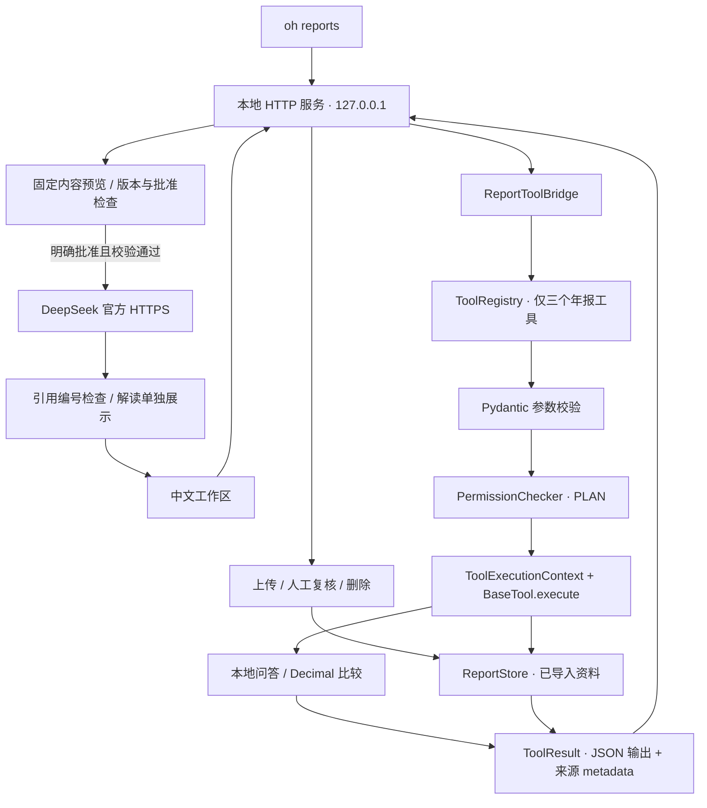

# 年报分析助手：实际技术架构

## 架构定位

这是接入 OpenHarness 原生工具体系的本地年报工作流。它复用项目已有模型配置和凭据解析，新增了年报提取、复核、计算、来源查看和精确外发预览。

本版由用户和程序控制步骤，使用三个受限只读工具。DeepSeek 仅处理用户批准后的固定请求，当前没有运行通用模型自主工具循环，也没有注册 Shell、Web 或任意文件读取工具。

## 主要调用路径

上传、复核和删除是本地服务的显式写操作，由 HTTP 请求边界与 `ReportStore` 校验；它们不是由只读工具或模型自动发起。

## 入口与组件

以下路径均相对于项目根目录。

| 文件 | 实际职责 |
| --- | --- |
| `src/openharness/cli.py` | 注册 `oh reports`，支持本地端口与打开浏览器选项 |
| `src/openharness/annual_reports/__main__.py` | 支持模块方式启动 |
| `src/openharness/annual_reports/server.py` | 本地 HTTP 路由、请求边界、工具桥接、预览确认、导出 |
| `src/openharness/annual_reports/harness.py` | 原生工具类、注册、参数校验、PLAN 权限、执行上下文和标准结果 |
| `src/openharness/annual_reports/extraction.py` | PDF 本地文字与候选指标提取，保留单位、年度、页码和原文 |
| `src/openharness/annual_reports/rendering.py` | 本地渲染已导入 PDF 的源页 PNG，限定尺寸和内存缓存；不依赖浏览器 PDF 嵌入 |
| `src/openharness/annual_reports/store.py` | 仅管理已导入资料、来源金额校验、人工复核记录与版本指纹 |
| `src/openharness/annual_reports/analysis.py` | 已确认数据的可比检查、Decimal 计算、本地问答和底稿内容 |
| `src/openharness/annual_reports/model.py` | 既有模型配置解析、固定请求、预览状态和模型引用检查 |
| `src/openharness/annual_reports/static/` | 本地 HTML、CSS 和 JavaScript 交互，无外部资源依赖 |
| `src/openharness/config/settings.py` | 复用模型 profile、服务地址和 `resolve_auth()` 等配置能力 |
| `src/openharness/auth/` | 复用凭据存取和鉴权来源能力，不把密钥交给浏览器 |

## OpenHarness 原生工具的实际接入

三个工具都继承 `openharness.tools.base.BaseTool`，不是只在说明文档里引用名称。

| 工具 | Pydantic 参数 | 实际服务使用位置 |
| --- | --- | --- |
| `annual_report_search` | `question`，有长度和非空限制，不允许额外字段 | `/api/ask`；模型预览前的本地检索 |
| `annual_report_page` | 已导入报告的 20 位内容 ID；1 至 500 的整数物理页码 | 原文文字页接口；源页 PNG 与原 PDF 读取前的权限和页码检查 |
| `annual_report_compare` | 空参数对象，不允许路径或额外字段 | `/api/state`；预览中的比较结果；导出所用状态 |

每次执行的顺序是：

1. `ToolRegistry.get(name)` 查找已注册工具，未知工具直接拒绝。
2. `input_model.model_validate(arguments)` 进行实际 Pydantic 校验，拒绝多余路径字段、非法报告 ID、布尔或字符串页码等。
3. `PermissionChecker(PermissionSettings(mode=PLAN))` 结合工具的 `is_read_only()` 作出权限决定；拒绝或需要确认的结果不会进入执行。
4. 建立真实 `ToolExecutionContext`，工作目录为年报存储根目录，metadata 标明应用和资料边界。
5. 调用原生 `BaseTool.execute()`，结果使用框架 `ToolResult`：`output` 是 JSON 字符串，`metadata.sources` 保留来源，`is_error` 显式表示失败。
6. `dispatch()` 为线程式 HTTP 服务提供同步适配；服务接口取标准结果里的业务 JSON 返回页面。

桥接器提供 `tools_schema`，直接使用 `ToolRegistry.to_api_schema()` 生成框架原生 schema；也提供 `tool_names`。应用状态显示框架标识、三个工具名称、PLAN 模式以及 `autonomous_model_loop: false`。

工具 schema 当前用于统一工具定义与校验，不发送给 DeepSeek 请求。不能把这个接入描述为模型正在自主选择 function calling 工具。

## 工具权限与数据范围

页工具只接受报告 ID 和页码，使用 `ReportStore.get()` 检查报告是否已导入，再读取已有页索引。它不接收绝对路径，不扫描用户目录，不从模型文本执行命令。查询和比较也只访问当前工作区数据。

PLAN 只读检查确实运行，但它只是这三个工具的执行规则，不等于操作系统隔离或完整数据防泄漏。外发模型请求另有明确批准机制，不能用“工具可只读执行”代替“用户允许发送数据”。

资料上传、复核和删除由独立服务接口处理。HTTP 服务只绑定回环地址，对修改请求检查 Host、Origin 和本次运行 token；输入大小、文件类型、报告 ID、页码和来源金额还要经过业务层校验。源页 PNG 与原始 PDF 读取前也经过原生页工具检查。源页图像由本地 PDFium 渲染，以限定尺寸的 PNG 返回页面，保留提取文字与打开原 PDF 的入口；渲染操作串行保护，少量缓存只保留在内存中。

## 财务数据处理

原文金额保留为十进制字符串及原始单位。确认后的指标还需明确公司、年度、币种、合并范围和来源，才可进入正式计算。应用统一换算为人民币元，使用 Decimal 计算差额与同比。

缺失值不当作零；零或负数基数不列常规增长率；不同公司、币种或非相邻报告年度不强行同比。较新年报同表可比期优先，即使旧报告已有确认值，较新候选仍须先复核。重述或提取差异会保留核对提示。

原始提取与人工修正记录分开保存。来源金额校验要求所选页出现该金额，但这仍不能自动证明用户选中了正确年度、指标列或范围，所以界面上的人工确认不可省略成“一键保证准确”。

本地问答优先使用这些确定性结果。披露、原因和风险问题通过规则及关键词查找页片段，证据不足时说明不足；当前没有 embedding、向量数据库或独立的语义 RAG 系统。

## 单次模型请求与批准流程

- 请求包括固定系统规则、用户问题、可用的已确认财务事实和少量来源节选。不自动注入通用 Agent 的历史会话、记忆或本地规则文件。
- `PreviewManager` 保存请求对象的副本，生成预览 ID，并记录资料与复核状态的指纹。界面修改预览不会改写服务端保存的请求。
- 预览有效期为十分钟。发送操作检查指纹和时效；资料或核对结果变化后需要重新预览。
- 只有 `approved is True` 才能发送。预览在调用前消费，重复使用或失败后重用会被拒绝，用户需要重新预览。
- 预览展示 SHA-256 供对照；它不是数字签名，也不替代服务端 token、版本和批准检查。界面预览与请求发送保持相同 JSON 内容，不承诺二者的空白格式或字节序列相同。
- 模型配置和密钥通过既有 profile 与 `resolve_auth()` 在服务端解析；密钥不包含在预览 JSON 内。配置状态只说明本地配置可解析，不能代替真实连通和余额验证。
- 外发仅允许 DeepSeek 官方 HTTPS 地址和标准端口，不跟随重定向，避免把鉴权头转交给重定向目标。这个约束只适用于本应用的模型请求，不是整个项目所有程序的全局出站网关。
- 模型响应中的规范引用标记采用 `[R1·PDF第5页]` 形式。识别到的编号必须属于本次提供的来源集合；没有标记时显示提示。编号合法不证明每句内容都被原文支持，也不能消除模型幻觉。
- 请求失败或超时不代表远端一定未收到内容。获准发送的数据仍受外部服务的数据处理规则约束。

## 已有能力与新增工作

| 复用能力 | 新增场景实现 |
| --- | --- |
| OpenHarness CLI、`BaseTool`、`ToolRegistry` | `oh reports` 命令、三个年报工具与真实路由接入 |
| Pydantic 输入模型、`PermissionChecker`、PLAN 模式 | 年报问题、导入 ID 和页码参数约束；只读业务边界 |
| `ToolExecutionContext`、`ToolResult` | 来源 metadata 与线程式服务同步桥接 |
| 模型 profile、密钥解析与凭据存储 | 精确模型预览、资料版本绑定、一次性批准与引用编号检查 |
| Python 运行环境 | PDF 提取、人工复核、Decimal 比较、资料存储、中文界面和导出 |

## 验证与明确边界

相关测试位于 `tests/test_annual_reports/`：提取和计算用例检查金融边界；`test_harness.py` 检查原生注册与 schema、真实参数校验、权限决定能否阻止执行、资料边界和来源；隐私用例检查预览与发送限制。最终测试数量、真实 PDF 样本结果和界面验收以最终运行记录为准。

当前没有自定义训练、微调模型、完整 DLP、自动 Shell 执行、语义向量检索、通用自主 Agent 循环或规模化用户验证。本地数据不因留在设备上就自动加密。产品价值应通过可核对任务的实际完成情况验证，不能由框架接入或测试通过数直接推导商业效果。
